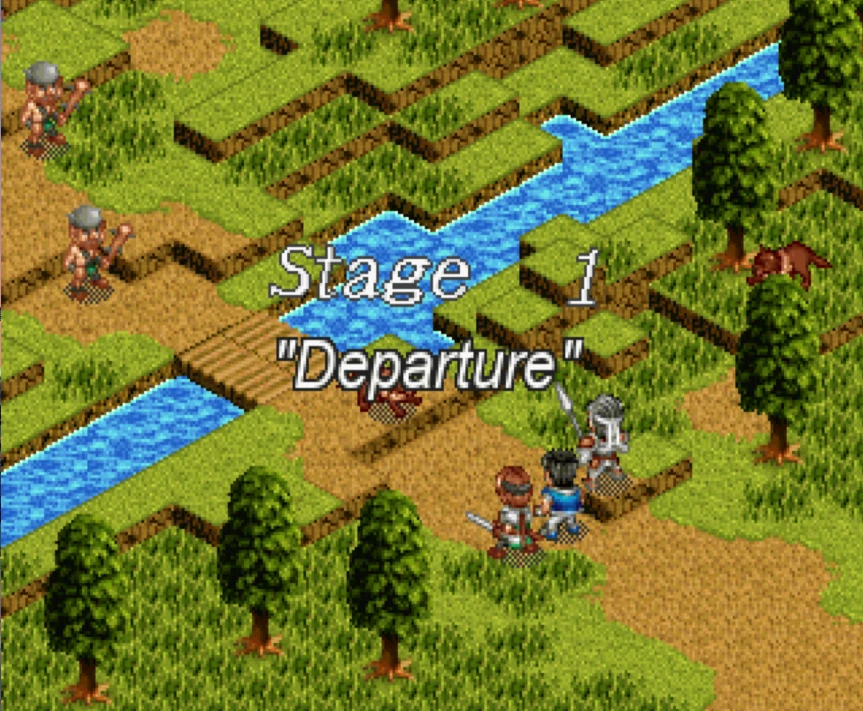
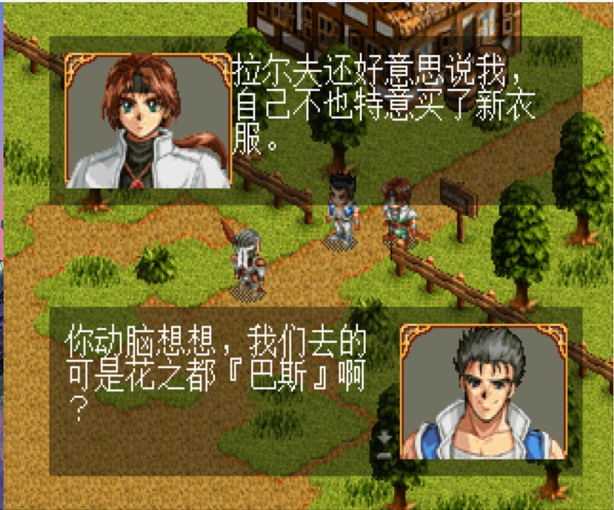
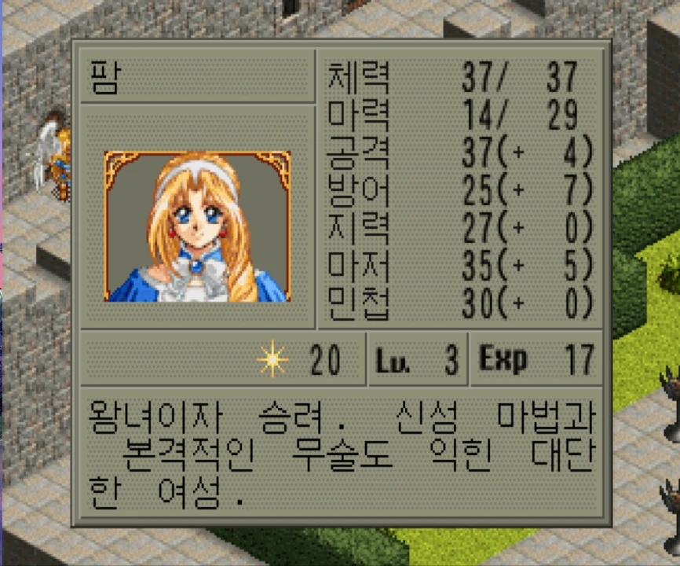

# FARLAND SAGA I Saturn Tribute Localization

<p align="center">
  <b>Language:</b>
  English •
  <a href="README_zh-CN.md">简体中文</a> •
  <a href="README_ko-KR.md">한국어</a>
</p>

<p align="center">
  <a href="https://github.com/ukjent7/Farland-Saga-localization/actions/workflows/ci.yml"></a>
  <a href="https://goreportcard.com/report/github.com/ukjent7/Farland-Saga-localization"></a>
</p>

> [!WARNING]
> **Alpha Preview Stage**: This patch is currently in early testing for preview purposes only and should not be considered a final release. Please report any issues you encounter.

A lightweight, fully self-contained localization tool and patch engine for Steam's **FARLAND SAGA I Saturn Tribute**, supporting **English**, **Simplified Chinese (简体中文)**, and **Korean (한국어)**.

Built with a declarative in-place injection engine: 100% free of commercial copyright infringement, self-contained repository with zero external binary dependencies, and a single-executable patcher (~16MB).

---

## In-Game Preview

| English | 简体中文 | 한국어 |
| :---: | :---: | :---: |
|  |  |  |

---

## Quick Start (Player Guide)

1. Download the latest `FarlandSagaPatcher.exe` (or zip bundle) from [Releases](https://github.com/ukjent7/Farland-Saga-localization/releases).
2. Place the executable into your Steam game directory (alongside `FarlandSaga.exe`).
3. Launch the patcher:
   - **Install**: Select your language and click **Install**;
   - **Switch**: Click **Back** to select another language;
   - **Restore**: Click **Restore** anytime to return to the pristine, unmodified game.

> [!NOTE]
> Please completely exit the game before patching. The patcher automatically creates a protected backup on first run.

---

## Key Features

- **Native Injection Engine**: Built-in Saturn CD-ROM MODE1 EDC/ECC recalculation, SSF Steam container cryptography, and RGBA overlay font stream compressor.
- **Format 2 Sparse Compression**: Eliminates bloating and proprietary font embedding; the single executable embeds all 3 languages in just ~16MB.
- **Safe Single-Snapshot Backup**: Atomically verifies SHA-256 hashes before and after writing, rolling back instantly on any mismatch.
- **CI Ready & 100% Compliant**: GitHub Actions automatically builds release binaries in the cloud without proprietary assets.

---

## Developer Guide

Requires: Linux/WSL2, Python 3.14+ (via `uv`), Go 1.23+.

```bash
# Run unit & regression test suites
bash flow.sh test --cli-only
bash flow.sh test --quick

# Check translation & review page
bash flow.sh merge
bash flow.sh review

# Verify candidates & build standalone Windows patcher
bash flow.sh status
bash flow.sh build-patcher
```

---

## Disclaimer

- This fan localization is independently developed for educational and research purposes. It contains no proprietary commercial game binaries or copyrighted fonts.
- A legitimate, purchased copy of *FARLAND SAGA I Saturn Tribute* on Steam is required.

---

## 🤝 Community & Compute Support

This is a non-profit, hobbyist open-source project. Any form of contribution is warmly welcomed—submitting PRs, refining translations, testing releases, or sharing technical advice.

> **A Note on Compute & AI Support**:  
> The project involves reverse engineering legacy Sega Saturn (SH-2) code, CD-ROM parity recalculation, and Unity binary patching. Currently, resolving intricate edge-case bugs using lightweight AI models has been heavily bottlenecked (burning through 500~600M tokens over two days with little progress on subtle issues).  
> If anyone has spare **ChatGPT Plus / GPT Team** seats or advanced AI reasoning compute willing to share/lend for project development, it would be immensely appreciated! Any assistance, from debugging insights to compute sharing, makes a huge difference.
